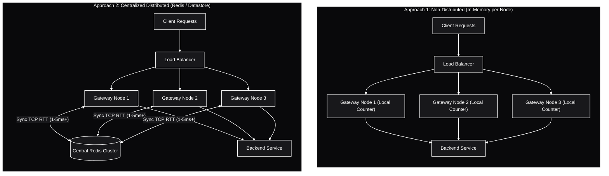
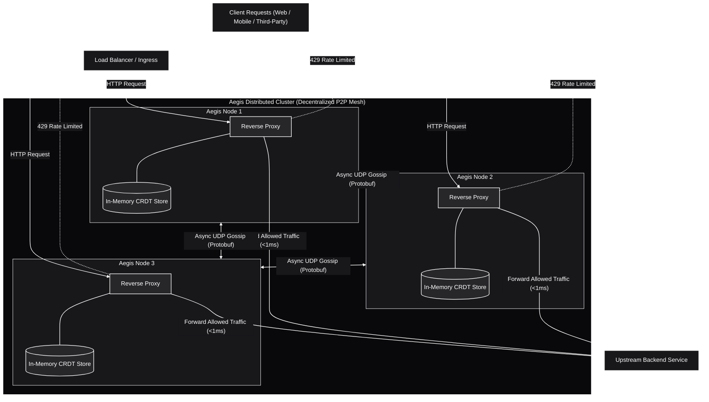
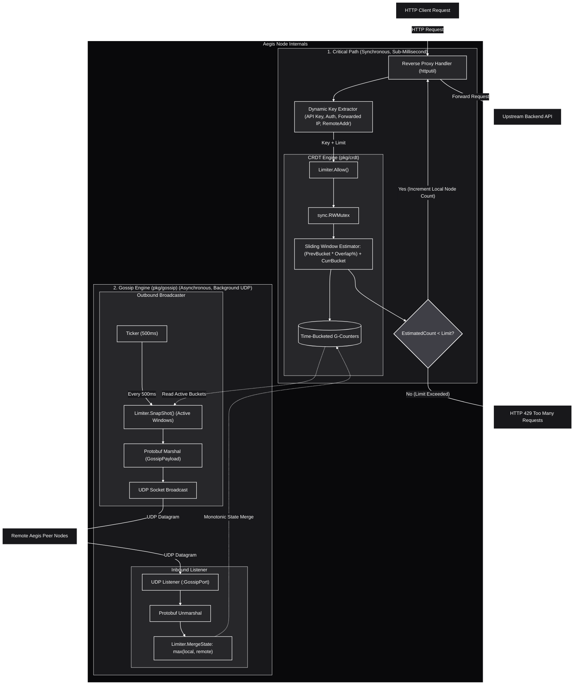

# Aegis

Aegis is a high-performance, decentralized distributed rate limiter built in Go.

Traditional rate limiters often rely on centralized data stores (like Redis), which can introduce latency and become bottlenecks in the critical path of API gateways.
Aegis eliminates this single point of failure by evaluating rate limits entirely in-memory and sharing state across nodes through peer-to-peer communication.

## Core Concepts

* **Decentralized State:** Pairs Conflict-free Replicated Data Types (CRDTs) with an asynchronous background UDP gossip protocol to aggregate rate limit data across the cluster.
* **Extreme Performance:** Designed for sub-millisecond, in-memory rate-limit evaluation, ensuring your API gateway is never blocked by a database lookup.
* **Eventual Consistency:** Nodes efficiently broadcast their local time-bucketed counts to peers in the background, merging state seamlessly without distributed locking.

## How It Works

Aegis uses a **Sliding Window Counter** built on top of time-bucketed G-Counters (a type of CRDT).
Each node maintains its own local counters and periodically gossips its state to peers over UDP using Protocol Buffers.
When a rate-limit check happens, the sliding window algorithm calculates a weighted estimate from the current and previous time buckets to decide whether to allow or reject (HTTP 429) the request.

---

## Architecture & System Design

### 1. Traditional Approaches vs Decentralized Model

Rate limiters have historically fallen into two primary categories, both of which exhibit significant engineering trade-offs:

1. **Non-Distributed (Local In-Memory Counter):**
   Each node maintains its own independent in-memory counter.
   While latency is near-zero, limits are fragmented across the cluster.
   In a cluster of $N$ nodes behind a round-robin load balancer, an attacker can consume $N \times \text{Limit}$ requests before being throttled.
   Uneven traffic distribution causes inaccurate rate enforcement.

2. **Centralized Distributed (Redis / Memcached):**
   Gateway nodes query a centralized in-memory datastore synchronously on every incoming request.
   While global accuracy is achieved, every HTTP request pays a network round-trip penalty (typically 1-5ms+).
   The centralized store becomes a single point of failure (SPOF) and an operational bottleneck under high traffic spikes.

---

### 2. Aegis High-Level Design (HLD)

Aegis decouples rate limit evaluation from cross-node synchronization:

* **The Critical Path (<1ms):** Requests are evaluated purely in-memory on the receiving node using local CRDT state.
  No synchronous database queries or distributed locks block the HTTP proxy path.
* **The Background Path:** Nodes continuously gossip state deltas to peers asynchronously over UDP using Protocol Buffers.
* **Convergence:** The CRDT state convergence guarantees eventual consistency across all nodes without centralized coordination.

---

### 3. Aegis Low-Level Design (LLD)

Internally, an Aegis node executes two separate concurrency loops:

1. **Synchronous Request Processing:**
   * Inbound HTTP requests pass through the reverse proxy handler.
   * The identifier is extracted using the dynamic 4-tier hierarchy:
     `X-API-Key` -> `Authorization: Bearer` -> `X-Forwarded-For` / `CF-Connecting-IP` -> `RemoteAddr`.
   * [`crdt.Limiter`](file:///home/dj/Drive2/aegis/pkg/crdt/limiter.go#L10) retrieves the current and previous time buckets.
   * The sliding window estimate is computed:
     $\text{EstimatedCount} = (\text{PrevCount} \times \text{Overlap\%}) + \text{CurrCount}$.
   * If $\text{EstimatedCount} \ge \text{Limit}$, the request is immediately rejected with `HTTP 429 Too Many Requests`.
   * If permitted, the local node counter in [`crdt.GCounter`](file:///home/dj/Drive2/aegis/pkg/crdt/gcounter.go#L6) is incremented and the request forwards to upstream.

2. **Asynchronous UDP Gossip Engine:**
   * **Broadcaster:** Every 500ms, [`gossip.Engine`](file:///home/dj/Drive2/aegis/pkg/gossip/gossip.go#L14) takes a snapshot of active window counters, serializes them to Protobuf [`GossipPayload`](file:///home/dj/Drive2/aegis/api/proto/state.proto#L12), and sends UDP datagrams to configured peers.
   * **Listener:** Inbound UDP datagrams on `GossipPort` are decoded from Protobuf and merged into local state using the commutative max rule:
     $\text{local}[i] = \max(\text{local}[i], \text{remote}[i])$.

---

## Project Status

Aegis is in active development.
The following milestones have been completed:

- [x] Project scaffolding, YAML config loader, and entrypoint ([`cmd/proxy`](file:///home/dj/Drive2/aegis/cmd/proxy/main.go))
- [x] Protobuf schema for G-Counter vector clocks and gossip payloads ([`api/proto/state.proto`](file:///home/dj/Drive2/aegis/api/proto/state.proto))
- [x] Thread-safe G-Counter and Sliding Window rate limiter ([`pkg/crdt`](file:///home/dj/Drive2/aegis/pkg/crdt))
- [x] UDP gossip protocol for peer state synchronization ([`pkg/gossip`](file:///home/dj/Drive2/aegis/pkg/gossip))
- [x] Reverse proxy with HTTP 429 enforcement ([`cmd/proxy`](file:///home/dj/Drive2/aegis/cmd/proxy/main.go))

Currently working towards:

- [ ] Resolving bare-metal audit items (unit test suite, memory eviction, graceful shutdown)
- [ ] Phase 2: Containerization (Distroless Dockerfile, multi-node `docker-compose.yaml`)
- [ ] Phase 3: Chaos Testing (Toxiproxy partition tests, Vegeta latency benchmarks)
- [ ] Phase 4: Cloud-Native Delivery (Kubernetes manifests, Helm chart)

---
*See [GEMINI.md](file:///home/dj/Drive2/aegis/GEMINI.md) for the full development guide, architecture details, and coding standards.*
