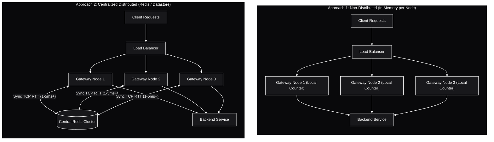
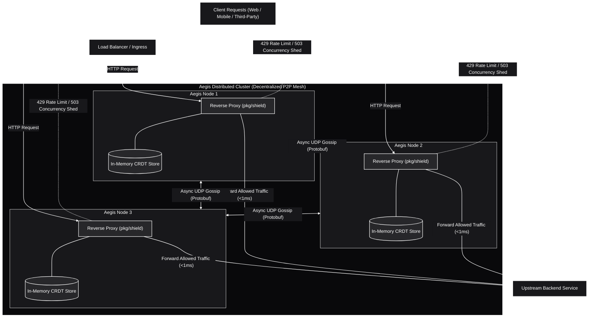
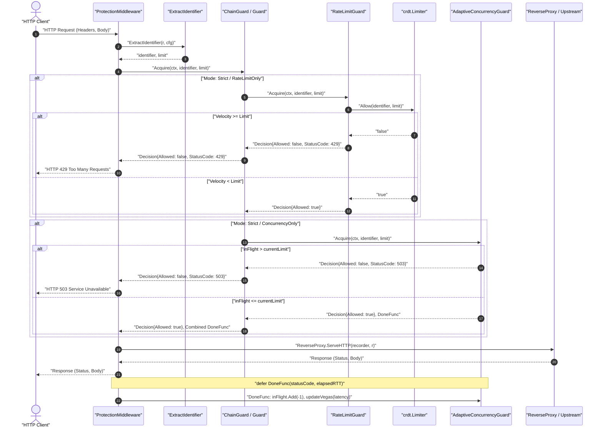
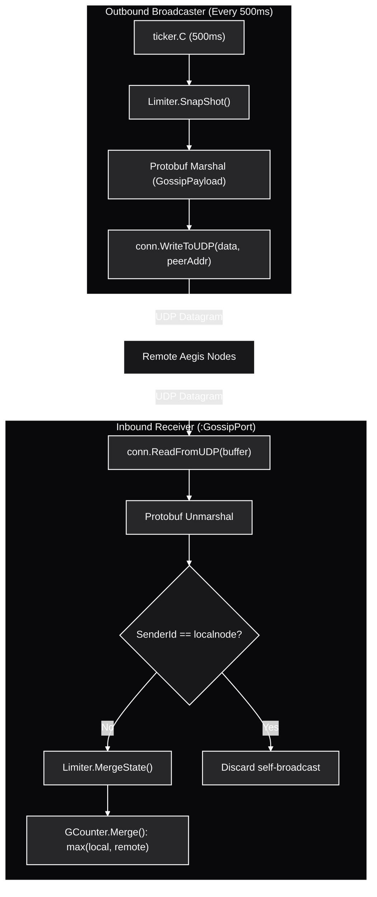

# Aegis

Aegis is a high-performance, decentralized distributed rate limiter and load shedding reverse proxy built in Go.

Traditional rate limiters often rely on centralized data stores (like Redis), which introduce latency and become bottlenecks in the critical path of API gateways.
Aegis eliminates this single point of failure by evaluating rate limits entirely in-memory and sharing state across nodes through peer-to-peer communication.
In addition, Aegis incorporates local adaptive concurrency limiting (TCP Vegas gradient) to shed load and prevent cascading backend worker exhaustion.

## Core Concepts

* **Decentralized State:** Pairs Conflict-free Replicated Data Types (CRDTs) with an asynchronous background UDP gossip protocol to aggregate rate limit data across the cluster.
* **Extreme Performance:** Designed for sub-millisecond, in-memory rate-limit evaluation, ensuring your API gateway is never blocked by a database lookup.
* **Dual Protection Shield:** Combines cluster-wide velocity rate limiting (requests/minute) with local TCP Vegas adaptive concurrency control (in-flight request load shedding).
* **Eventual Consistency:** Nodes efficiently broadcast their local time-bucketed counts to peers in the background, merging state seamlessly without distributed locking.

## How It Works

Aegis provides two complementary layers of protection orchestrated via a pluggable [`Guard`](file:///home/dj/Drive2/aegis/pkg/shield/shield.go#L17) interface:

1. **Velocity Rate Limiting (`pkg/crdt`):** Uses a **Sliding Window Counter** built on top of time-bucketed G-Counters (a CRDT).
   Each node maintains its own local counters and periodically gossips its state to peers over UDP using Protocol Buffers.
   When a rate-limit check happens, the sliding window algorithm calculates a weighted estimate from the current and previous time buckets to decide whether to allow or reject (`HTTP 429 Too Many Requests`).

2. **Adaptive Concurrency Limiting (`pkg/shield`):** Uses the **TCP Vegas gradient queue-delay algorithm** to dynamically measure upstream round-trip latency (RTT).
   If queue backlogs build up because backend dependencies are slow, Aegis dynamically sheds excess load (`HTTP 503 Service Unavailable`) before worker pools exhaust.

---

## Architecture & System Design

### 1. Traditional Approaches vs Decentralized Model

Rate limiters have historically fallen into two primary categories, both of which exhibit significant engineering trade-offs:

1. **Non-Distributed (Local In-Memory Counter):**
   Each node maintains its own independent in-memory counter.
   While latency is near-zero, limits are fragmented across the cluster.
   In a cluster of $N$ nodes behind a round-robin load balancer, an attacker can consume $N \times \text{Limit}$ requests before being throttled.
   Uneven traffic distribution causes inaccurate rate enforcement.

2. **Centralized Distributed (Redis / Memcached):**
   Gateway nodes query a centralized in-memory datastore synchronously on every incoming request.
   While global accuracy is achieved, every HTTP request pays a network round-trip penalty (typically 1-5ms+).
   The centralized store becomes a single point of failure (SPOF) and an operational bottleneck under high traffic spikes.

---

### 2. Aegis High-Level Design (HLD)

Aegis decouples rate limit evaluation from cross-node synchronization:

* **The Critical Path (<1ms):** Requests are evaluated purely in-memory on the receiving node using local CRDT state and adaptive concurrency gates.
  No synchronous database queries or distributed locks block the HTTP proxy path.
* **The Background Path:** Nodes continuously gossip state deltas to peers asynchronously over UDP using Protocol Buffers.
* **Convergence:** The CRDT state convergence guarantees eventual consistency across all nodes without centralized coordination.

---

### 3. Aegis Low-Level Design (LLD)

This section provides a complete reference for every package, struct, interface, function, and execution flow in Aegis.
It is intended to help contributors and reviewers understand the codebase in depth.

#### 3.1. End-to-End Function Call Graphs

##### Call Graph 1: Inbound HTTP Request Evaluation & Concurrency Control

##### Call Graph 2: Background UDP Gossip Broadcast & State Ingestion

---

#### 3.2. Detailed Package Reference

##### 1. Package [`pkg/config`](file:///home/dj/Drive2/aegis/pkg/config/config.go)
* **[`Config`](file:///home/dj/Drive2/aegis/pkg/config/config.go#L13):** Root struct holding `ProxyPort`, `GossipPort`, `Peers`, `BackendURL`, and `ProtectionConfig`.
* **[`ProtectionConfig`](file:///home/dj/Drive2/aegis/pkg/config/config.go#L25):** Controls mode (`"RateLimitOnly"`, `"ConcurrencyOnly"`, or `"Strict"`) and embeds rate/concurrency configs.
* **[`RateLimitConfig`](file:///home/dj/Drive2/aegis/pkg/config/config.go#L32):** Holds `Window` duration string, `AuthRateLimit`, and `IPRateLimit`.
* **[`ConcurrencyConfig`](file:///home/dj/Drive2/aegis/pkg/config/config.go#L38):** Holds `MinInFlight`, `InitialLimit`, `MaxInFlight`, `Alpha`, `Beta`, and `WindowSize`.
* **[`LoadConfig(path)`](file:///home/dj/Drive2/aegis/pkg/config/config.go#L142):** Reads and parses the YAML file from disk, calling `Validate()`.
* **[`(*Config).Validate()`](file:///home/dj/Drive2/aegis/pkg/config/config.go#L48):** Validates port numbers, URL formatting, duration parsing, and boundary relations (`MinInFlight <= InitialLimit <= MaxInFlight` and `Alpha < Beta`).

##### 2. Package [`pkg/crdt`](file:///home/dj/Drive2/aegis/pkg/crdt)
* **[`GCounter`](file:///home/dj/Drive2/aegis/pkg/crdt/gcounter.go#L6):** Thread-safe Grow-Only Counter CRDT.
  * [`Increment(nodeID)`](file:///home/dj/Drive2/aegis/pkg/crdt/gcounter.go#L20): Atomically increments local count under a write lock.
  * [`Value()`](file:///home/dj/Drive2/aegis/pkg/crdt/gcounter.go#L28): Calculates the sum of counts across all nodes under a read lock.
  * [`Merge(remoteCounts)`](file:///home/dj/Drive2/aegis/pkg/crdt/gcounter.go#L40): Applies the CRDT join-semilattice merge: $\text{local}[i] = \max(\text{local}[i], \text{remote}[i])$.
  * [`State()`](file:///home/dj/Drive2/aegis/pkg/crdt/gcounter.go#L53): Returns a thread-safe deep copy of the vector clock for gossip broadcast.
* **[`Limiter`](file:///home/dj/Drive2/aegis/pkg/crdt/limiter.go#L11):** Sliding window rate limiter engine.
  * [`NewLimiter(localNode, windowSize)`](file:///home/dj/Drive2/aegis/pkg/crdt/limiter.go#L21): Initializes the state map and starts the background janitor loop.
  * [`Allow(identifier, limit)`](file:///home/dj/Drive2/aegis/pkg/crdt/limiter.go#L115): Implements the sliding window formula:
    $\text{EstimatedCount} = (\text{PreviousCounts} \times \text{Overlap}) + \text{CurrentCounts}$.
    Returns `true` and increments local counter if within limit, or `false` if exceeded.
  * [`SnapShot()`](file:///home/dj/Drive2/aegis/pkg/crdt/limiter.go#L151): Returns a deep copy of active, non-stale buckets for UDP transmission.
  * [`MergeState(remoteState)`](file:///home/dj/Drive2/aegis/pkg/crdt/limiter.go#L169): Merges remote vector clocks into local bucket state.
  * [`EvictStale()`](file:///home/dj/Drive2/aegis/pkg/crdt/limiter.go#L73): Deletes buckets older than $2 \times \text{windowSize}$ to prevent memory leaks.
  * [`Close()`](file:///home/dj/Drive2/aegis/pkg/crdt/limiter.go#L107): Terminates the background cleanup janitor cleanly.

##### 3. Package [`pkg/gossip`](file:///home/dj/Drive2/aegis/pkg/gossip)
* **[`Engine`](file:///home/dj/Drive2/aegis/pkg/gossip/gossip.go#L14):** Asynchronous UDP gossip synchronization engine.
  * [`NewEngine(limiter, localnode, cfg)`](file:///home/dj/Drive2/aegis/pkg/gossip/gossip.go#L21): Creates a new gossip engine instance.
  * [`Start()`](file:///home/dj/Drive2/aegis/pkg/gossip/gossip.go#L29): Spawns the background listener and broadcaster goroutines.
  * [`listenUDP()`](file:///home/dj/Drive2/aegis/pkg/gossip/gossip.go#L34): Listens on `GossipPort` with a safe 1400-byte MTU buffer, unmarshals Protobuf messages, filters self-broadcast loops, and merges remote states into the limiter.
  * [`broadcastUDP()`](file:///home/dj/Drive2/aegis/pkg/gossip/gossip.go#L85): Ticks every 500ms, snapshots non-stale buckets, serializes to Protobuf [`GossipPayload`](file:///home/dj/Drive2/aegis/api/proto/state.proto#L12), and sends UDP datagrams to all peers.

##### 4. Package [`pkg/shield`](file:///home/dj/Drive2/aegis/pkg/shield)
* **[`Guard`](file:///home/dj/Drive2/aegis/pkg/shield/shield.go#L18):** Universal interface for protection strategies:
  `Acquire(ctx, identifier, limit) (Decision, DoneFunc)`.
* **[`Decision`](file:///home/dj/Drive2/aegis/pkg/shield/shield.go#L9):** Struct containing `Allowed`, `StatusCode` (429 or 503), and `Reason`.
* **[`DoneFunc`](file:///home/dj/Drive2/aegis/pkg/shield/shield.go#L16):** Callback invoked when an HTTP request completes: `func(statusCode int, latency time.Duration)`.
* **[`RateLimitGuard`](file:///home/dj/Drive2/aegis/pkg/shield/ratelimit.go#L12):** Wraps [`crdt.Limiter`](file:///home/dj/Drive2/aegis/pkg/crdt/limiter.go) to reject excess velocity with `HTTP 429`.
* **[`AdaptiveConcurrencyGuard`](file:///home/dj/Drive2/aegis/pkg/shield/concurrency.go#L12):** Implements local TCP Vegas gradient load shedding:
  * Tracks in-flight requests atomically via `inFlight atomic.Int64`.
  * Computes queue backlog: $\text{QueueSize} = \text{CurrentLimit} \times (1 - RTT_{\min} / RTT_{\text{curr}})$.
  * Adjusts limit between `minLimit` and `maxLimit` based on $\alpha$ and $\beta$ thresholds.
  * Ignores upstream 5xx errors to prevent artificial limit collapse during backend errors.
  * Periodically resets $RTT_{\min}$ to prevent stale baseline poisoning.
* **[`ChainGuard`](file:///home/dj/Drive2/aegis/pkg/shield/composite.go#L12):** Combines multiple guards sequentially with automatic rollback if a downstream guard rejects.
* **[`BuildGuard(cfg, rateLimiter)`](file:///home/dj/Drive2/aegis/pkg/shield/composite.go#L53):** Factory function creating the appropriate Guard hierarchy based on `Protection.Mode`.
* **[`ExtractIdentifier(r, cfg)`](file:///home/dj/Drive2/aegis/pkg/shield/middleware.go#L19):** Resolves client identity in strict precedence order:
  1. `X-API-Key`
  2. `Authorization: Bearer`
  3. `CF-Connecting-IP` / `X-Forwarded-For` (first IP)
  4. Raw `r.RemoteAddr` (parsed via `net.SplitHostPort` for IPv4 and IPv6)
* **[`ProtectionMiddleware(...)`](file:///home/dj/Drive2/aegis/pkg/shield/middleware.go#L69):** HTTP middleware intercepting requests, evaluating guards, proxying traffic, and recording metrics.

##### 5. Package [`cmd/proxy`](file:///home/dj/Drive2/aegis/cmd/proxy/main.go)
* **[`main()`](file:///home/dj/Drive2/aegis/cmd/proxy/main.go#L22):** Boots the application:
  1. Loads configuration.
  2. Parses backend upstream URL.
  3. Initializes CRDT limiter and starts UDP gossip engine.
  4. Builds unified Guard hierarchy.
  5. Configures reverse proxy with high-concurrency connection pooling (`MaxIdleConns: 2000`, `MaxIdleConnsPerHost: 1000`).
  6. Mounts protection middleware.
  7. Traps `SIGINT`/`SIGTERM` for graceful server drain and shutdown.

---

## Project Status

Aegis is in active development.
The following milestones have been completed:

- [x] Project scaffolding, YAML config loader, and entrypoint ([`cmd/proxy`](file:///home/dj/Drive2/aegis/cmd/proxy/main.go))
- [x] Protobuf schema for G-Counter vector clocks and gossip payloads ([`api/proto/state.proto`](file:///home/dj/Drive2/aegis/api/proto/state.proto))
- [x] Thread-safe G-Counter and Sliding Window rate limiter with memory eviction ([`pkg/crdt`](file:///home/dj/Drive2/aegis/pkg/crdt))
- [x] UDP gossip protocol for peer state synchronization ([`pkg/gossip`](file:///home/dj/Drive2/aegis/pkg/gossip))
- [x] Universal Guard pattern, TCP Vegas adaptive concurrency, and 429/503 enforcement ([`pkg/shield`](file:///home/dj/Drive2/aegis/pkg/shield))
- [x] Automated unit and race detection test suites (`make test`)

Currently working towards:

- [ ] Phase 2: Containerization (Distroless Dockerfile, multi-node `docker-compose.yaml`)
- [ ] Phase 3: Chaos Testing (Toxiproxy partition tests, Vegeta latency benchmarks)
- [ ] Phase 4: Cloud-Native Delivery (Kubernetes manifests, Helm chart)

---
*See [GEMINI.md](file:///home/dj/Drive2/aegis/GEMINI.md) for the full development guide, architecture details, and coding standards.*
